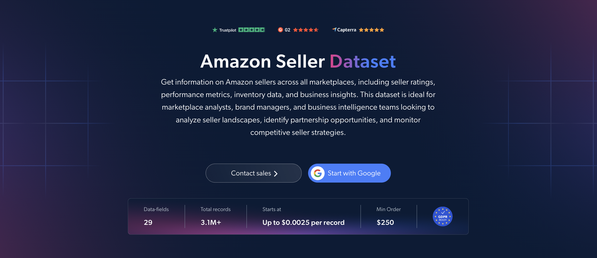

# Amazon-Sellers-dataset-samples

<h2>A sample dataset of 1000 Amazon sellers</h2>

<a href="https://brightdata.com/products/datasets/amazon/sellers">
   
</a>

An Amazon sellers dataset sample of 1000 seller profiles. Dataset was extracted using the <b>Bright Data API</b>.

<h2>Some of the data points that are included in the dataset:</h2>

* ```seller_id```: Unique identifier for each seller
* ```url```: URL of the seller's page on Amazon
* ```seller_name```: Name of the Amazon seller
* ```buisness_name```: Official business name of the seller
* ```country```: Country associated with the seller
* ```description```: Overview of the seller
* ```stars```: Average star rating based on feedback
* ```feedbacks```: Total number of feedbacks received
* ```rating_positive```: Percentage of positive ratings
* ```feedbacks_percentages```: Breakdown of positive, neutral and negative feedback
* ```rating_count_m1```: Number of ratings in the last month
* ```rating_count_m3```: Number of ratings in the last 3 months
* ```rating_count_m12```: Number of ratings in the last 12 months
* ```rating_count_lifetime```: Total lifetime number of ratings
* ```products_count```: Total number of products offered by the seller
* ```products_link```: Link to the seller's products
* ```brands```: Brands sold by the seller
* ```return_policy```: Seller's return policy
* ```shipping_policies```: Seller's shipping policies
* ```delivery_rates```: Seller's delivery rates

And a lot more.

This is a sample subset which is derived from the "Amazon Sellers Info (public data)"
dataset which includes more than <b>3,100,000 sellers</b>.

Available dataset file formats: <b>JSON, NDJSON, JSON Lines, CSV, XLSX, or Parquet. Optionally, files can be compressed to .gz</b>.

Dataset delivery type options: <b>Email, API download, Webhook, Amazon S3, Google Cloud storage, Google Cloud PubSub, Microsoft Azure, Snowflake, SFTP</b>.

Update frequency: <b>Once, Daily, Weekly, Monthly, Quarterly, Biannual, or Custom basis</b>.

Data enrichment available as an addition to the data points extracted: <b>Based on request.</b>

<b>[Get the full Amazon Sellers dataset](https://brightdata.com/products/datasets/amazon/sellers)</b>.

<a href="https://brightdata.com/products/datasets/amazon/sellers">
</a>

<h2>What are the Amazon Sellers datasets use cases?</h2>

<h3>1. Partnership opportunities</h3>
Brands and marketplaces use Amazon sellers datasets to discover high-performing sellers with proven track records. Analyzing star ratings, feedback volume and product range helps identify reliable partners for distribution, brand collaborations or marketplace expansion.

<h3>2. Competitor monitoring</h3>
Companies track competitor sellers' brands, product counts and customer feedback over time. Comparing rating counts across the last month, 3 months and 12 months shows which sellers are growing, which are losing momentum and how their positioning changes.

<h3>3. Seller performance analysis</h3>
Analysts compare seller ratings, positive feedback percentages and lifetime rating counts across countries and categories. This helps evaluate seller reliability, identify market trends and uncover growth opportunities on Amazon marketplaces.

<h2>Free access to web scraping tools and datasets for academic researchers and NGOs</h2>

The Bright Initiative offers access to Bright Data's <b>[Web Scraper APIs](https://brightdata.com/products/web-scraper)</b> and <b>[ready-to-use datasets](https://brightdata.com/products/datasets)</b> to leading academic faculties and researchers, NGOs and NPOs promoting various environmental and social causes. You can submit an application <b>[here](https://brightinitiative.com)</b>.
